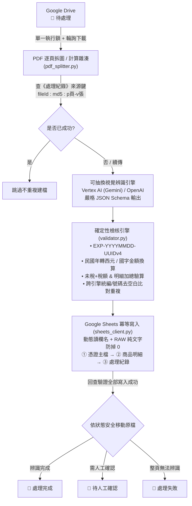

# 核銷憑證辨識與建檔助手 — 專案重點總覽

> 版本：v0.2（2026-11-14）

> 本文件整理自 `d:\340antigravity\expense-voucher-assistant` 實作成果，涵蓋設計源起、系統架構、實際應用場景與未來擴充方向。

---

## 一、 源起與設計目的

### 1. 為什麼要做這支程式？
在日常報帳與專案核銷流程中，整理紙本發票、熱感應紙收據、高鐵／台鐵車票與多頁掃描 PDF 時，常遇到三個痛點：
1. **人工建檔耗時易錯**：逐筆抄打買賣雙方統編、日期、金額與明細容易漏看或算錯。
2. **直接丟免費 AI 聊天工具風險高**：
   * 免費公開 AI 可能保留或訓練您的真實交易憑證（資安與保密疑慮）。
   * AI 在字跡模糊時容易「腦補猜字」，或自己算錯未稅／稅額加減。
3. **跨系統對帳與重跑混亂**：缺少唯一識別碼與處理紀錄時，重跑同一份 PDF 會造成試算表重複建檔或部分明細遺漏。

### 2. 四大核心設計鐵律
* **AI 只認字、不猜測**：看不清、被遮擋或原圖未列出的欄位一律留空並寫入原因，絕不捏造統編、日期或金額。
* **算數與稽核全交給確定性程式**：唯一代碼生成、民國年轉西元、中文大寫金額換算、稅額驗算與疑似重複檢查，100% 由 Python 規則引擎執行，計算值與原文值分欄保存。
* **人類保留最終審核權**：程式寫入時 `覆核狀態` 永遠鎖定為 `待覆核`，系統只提供建檔與檢查輔助，不代為認定真偽或是否可核銷。
* **保護原始憑證**：只透過 Google Drive API 在資料夾間移動檔案（`fileId` 與分享連結永久不變），絕不刪除原始檔。

---

## 二、 系統與程式架構

### 1. 整體資料流

### 2. 本機核心模組一覽

| 檔案 | 職責說明 |
| :--- | :--- |
| `main.py` | CLI 入口，支援完整雲端管線與 `--dry-run` 本機預覽測試 |
| `src/config.py` | 載入 `.env` 設定並驗證必要環境變數 |
| `src/models.py` | Pydantic 結構化資料模型與三張工作表標準欄位定義 |
| `src/lock.py` | 單一執行程序鎖（`.lock`），防止多排程並發寫壞 Google Sheets |
| `src/pdf_splitter.py` | 透過 PyMuPDF 將多頁 PDF 逐頁轉為高解析 PNG，並支援常見影像格式 |
| `src/ocr_provider.py` | 可抽換辨識介面（`OCRProvider`），內建 **Vertex AI Gemini**（含 `thinking_level="low"` 省 token 控制）與 **OpenAI**（Strict Schema + `detail="high"`） |
| `src/validator.py` | 純程式規則引擎：UUID 生成、`YYYY-MM-DD HH:MM:SS`（`Asia/Taipei`）、民國年與大寫國字換算、對帳驗算、正規化重複比對 |
| `src/google_auth.py` | 共用 Service Account / OAuth 認證模組 |
| `src/drive_client.py` | 輪詢待處理檔案、下載暫存、跨資料夾移動檔案（保留原檔連結） |
| `src/sheets_client.py` | 動態讀取第 1 列欄名映射、`RAW` 純文字寫入（保留前導 `0`）、部分寫入回查補寫 |
| `src/pipeline.py` | 串接完整流程、跨頁憑證關聯（`continues_from_prev_page`）、清理本機暫存與彙整執行報告 |

### 3. 雲端儲存與帳本結構

* **Google Drive 4 個資料夾**：`待處理` → `處理完成` / `待人工確認` / `處理失敗`（同一根目錄共用給單一服務帳號，移動後原連結不失效）。
* **Google Sheets 3 張工作表**：
  1. **`憑證主檔`**（25 欄）：一張憑證一列，記錄 `唯一代碼`、`建檔日期時間`、`辨識狀態`、`覆核狀態`、發票/車票號碼、買賣雙方資訊、金額與核對結果、`原始檔連結` 與 `疑似重複`。
  2. **`商品明細`**（8 欄）：一項商品／行程一列，透過 `唯一代碼 + 明細序號` 關聯主檔。
  3. **`處理紀錄`**（8 欄）：記錄 `來源識別碼／雜湊`（`DriveID:MD5:p頁-v張`）與對應的 `唯一代碼`，確保斷線重試冪等不重複。

---

## 三、 實測成果與日常應用

### 1. 已實測驗證的能力
* **單元測試**：涵蓋日期/國字換算、對帳檢核、統編前導 `0` 保留、部分寫入補寫、跨頁延續、OCR Schema 與單一程序鎖，共 **24 項測試全數通過**（`python -m pytest -v`）。
* **真實憑證實測**：
  * **熱感應紙統一發票**：正確擷取號碼、商家統編、日期與金額；淡化模糊品名處不硬猜，誠實標為 `需人工確認` 並歸檔至 `待人工確認/`。
  * **單張照片多張高鐵車票混拍（3 張同框）**：自動拆解為 `p1-v1`、`p1-v2`、`p1-v3` 三筆獨立主檔與明細，完整保留 `0` 開頭票號與起訖站、車次、座位。
  * **台鐵 QR 車票**：支援點號日期正規化（`2025.09.10` → `2025-09-10`）、區間起訖站與票價擷取。

### 2. 日常使用與成本特性
* **三種操作方式**：
  1. **本機試跑（不碰雲端）**：`python main.py --dry-run <檔案路徑>`，只把辨識結果印在畫面上，不寫試算表、不搬檔案，適合第一次測試或檢查某張憑證。
  2. **正式批次處理**：`python main.py` 掃一次 Drive `待處理` 資料夾，寫入試算表並把原檔歸檔；搭配 Windows 工作排程器可每天定時自動跑。
  3. **AI 助理一句話**：在 Claude Code 或 Antigravity 安裝 `skills\expense-voucher-assistant\SKILL.md`（直接跟 AI 說「幫我把這個專案的技能檔裝起來」即可），之後說「幫我處理待處理發票」，AI 會代為執行並整理結果報告。
* **費用優勢**：Google Drive 與 Sheets API 免費；Vertex AI 採用 `gemini-3-flash-preview`（`global`）搭配 `thinking_level="low"` 控制思考 token 消耗，單張發票成本極低（約新台幣 0.07～0.16 元級距），搭配 GCP 試用點數與 \$10 預算警報即可安心長期使用。

---

## 四、 未來可增加的進階功能（Roadmap）

> 先做最簡單、最實用的兩項；其餘等實際用得到再加。

1. **手機拍完直接傳（最簡單）**
   * **現在就能用**：手機安裝 Google Drive App，用「掃描」（存成 PDF）或拍照上傳到 `待處理` 資料夾，下次執行或排程時就會處理。程式目前收 PDF、JPG、PNG 等格式；iPhone 若存成 HEIC 格式，要先改成 JPG。
   * **之後再加**：LINE／Telegram 機器人，收據照片傳給機器人就自動存進 `待處理`，不用開 Drive App。
2. **公司統編自動比對（最實用）**
   * 在 `.env` 設定自己公司／機關的統編，`validator.py` 寫入前自動比對買受人統編：漏打或打錯就標為 `需人工確認`，並在備註寫明原因，報帳前就抓出來，不用等會計退件。
3. **其他可再考慮**
   * Gmail 電子發票自動歸檔：以 Apps Script 抓取電子發票通知、PDF 附件存入 `待處理`。
   * 會計科目建議：依商家或品名關鍵字建議「差旅費／辦公費／材料費」等科目。
   * 一鍵套印粘存單／請款單：讀取已標為 `已確認` 的紀錄，填入制式 Word／Excel 核銷單範本。

---

## 版本歷程

| 版本 | 日期 | 內容 |
|---|---|---|
| v0.2 | 2026-11-14 | 三種操作方式寫清楚各自用途；進階功能改成手機上傳、公司統編比對優先，拿掉多專案管理與企業級擴充 |
| v0.1 | 2026-11-14 | 初版總覽 |
